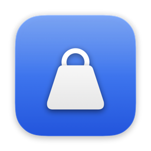
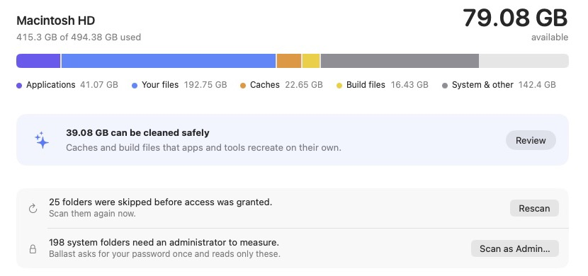

<div align="center">



# Ballast: Mac disk space analyzer and safe cleaner

**See where your Mac's disk space went, and get it back without breaking anything.**

[](https://github.com/reloadlife/ballast/actions/workflows/ci.yml)
[](https://github.com/reloadlife/ballast/releases/latest)
[](LICENSE)


<picture>
  <source media="(prefers-color-scheme: dark)" srcset="docs/overview-dark.png">
  
</picture>

[Download](https://github.com/reloadlife/ballast/releases/latest) · [Features](docs/features.md) · [FAQ](#faq) · [How it works](docs/how-it-works.md) · [Privacy](docs/privacy.md)

</div>

**Ballast is a free, open-source macOS app that measures every folder on your disk, shows what is using the space, and cleans what is safe to remove.** It is built for anyone whose Mac is full, and especially for developers: `node_modules`, Xcode DerivedData, Docker images, package caches and build output pile up fast and are hard to find.

## Quick start

1. Download `Ballast.zip` from the [latest release](https://github.com/reloadlife/ballast/releases/latest), unzip it, and move **Ballast** to Applications.
2. Open it. The first time, macOS blocks it because the build isn't notarized: open **System Settings › Privacy & Security** and click **Open Anyway**.
3. Recommended: turn on Ballast in **System Settings › Privacy & Security › Full Disk Access**, then reopen it, so it can measure Mail, Photos and app data too.

The first scan takes about two minutes on a 500 GB Mac. After that, Ballast keeps itself current from the macOS change log, in seconds.

## What Ballast finds

| Where space hides | Examples |
|---|---|
| **Caches** | `~/Library/Caches`, npm, Bun, pnpm, Yarn, pip, uv, Go, Cargo, Gradle, Maven, CocoaPods, logs |
| **Build output** | `node_modules`, `.next`, `dist`, Rust `target`, `.build`, `Pods`, Python venvs, `.terraform` and [many more](docs/features.md#suggestions) |
| **Developer tools** | Xcode DerivedData, archives, simulators, device support, Android images, Ollama models, Homebrew |
| **Containers and VMs** | Docker Desktop, OrbStack, Colima, Lima, Podman, Rancher Desktop |
| **Temporary files** | `/tmp`, your per-user temporary folder, deployment copies, coding-agent worktrees |
| **Forgotten files** | Folders untouched for months, unused apps with their data, installers, duplicates, the largest files |
| **System Data** | macOS, updates, swap, snapshots and caches, each explained, with what you can do about it |

## Safe by design

Every item gets a verdict with a plain reason, and the check runs again at the moment of deletion.

| Verdict | Examples | What happens |
|---|---|---|
| ✅ **Safe** | App caches, `node_modules`, DerivedData, old installers | Cleaned |
| ⏸ **Quit the app first** | Chrome's cache while Chrome is open | Waits for the app to close |
| ⚠️ **Check first** | Git repositories, temporary working copies, apps | Cleaned only after you confirm |
| ⛔ **Protected** | App data, Keychains, Mail, Photos, `.ssh`, `.git` | Never cleaned |

Files go to the Trash by default, and **Put Back** restores any cleanup. Tools with their own cleanup command (`npm cache clean`, `brew cleanup`, `docker system prune`) run that command instead.

## Highlights

- **Whole-disk index.** Every folder is measured, the way `du` counts it, not sampled.
- **Always current.** Changes are replayed from FSEvents while the app runs; no rescans.
- **What grew.** See which folders grew since yesterday, last week or last month.
- **Explorer.** A clickable treemap and table, with folder search across the whole disk.
- **Auto-clean rules.** For example, "delete `.next` once its project is untouched for 3 days".
- **Low-space alert, menu bar item and desktop widget.**
- **Shortcuts, Siri and Spotlight actions.**
- **Homebrew and Git worktree management**, with checks before anything is removed.
- **Other drives.** External drives and disk images get their own index.
- **Native SwiftUI**, Dark Mode, keyboard shortcuts and Reduce Motion.

See [every feature in detail](docs/features.md).

## FAQ

### How do I find out what is taking up space on my Mac?

Open Ballast. The Overview splits used space into Applications, your files, caches, build files and System Data. It also lists the largest folders and files and what grew recently. Click any folder to drill into it in Explorer.

### What is "System Data" on a Mac, and how do I reduce it?

System Data is everything macOS doesn't put in another category: temporary files, caches, swap, local Time Machine snapshots, logs, Homebrew, containers and VM disk images. Ballast breaks it down line by line and says what each part is. Where you can clean a part safely, it offers to, for example by thinning local snapshots.

### Is it safe to delete `node_modules`, DerivedData or `~/Library/Caches`?

Yes, they are rebuilt on the next install, build or launch. Ballast confirms each build folder by the file that proves it (`target/` only counts next to a `Cargo.toml`). It leaves the caches of running apps alone.

### How do I free up space used by Docker or OrbStack on a Mac?

Ballast measures their disk images where each tool keeps them. It offers `docker system prune`, which removes stopped containers, unused networks, dangling images and the build cache, and keeps your volumes.

### Does Ballast delete files permanently?

No, not by default. Items go to the Trash and every cleanup can be put back. Deleting permanently is a separate choice you have to make.

### Why does Ballast need Full Disk Access?

macOS hides Mail, Photos, iOS backups and some app data from every app unless you grant it. Without it, those folders can't be measured and Ballast says how many it couldn't read.

### Is Ballast free? Does it collect data?

Ballast is free and open source under the AGPL-3.0. Your file information never leaves your Mac. Anonymous usage data and update checks are off until you turn them on. [Privacy details](docs/privacy.md).

### Which Macs does it run on?

Any Mac running macOS 26 or later.

## Build from source

```sh
git clone https://github.com/reloadlife/ballast.git
cd ballast
./scripts/bundle.sh
open Ballast.app
```

Needs macOS 26 or later and Xcode (Xcode 27 adds the Shortcuts actions). See [Contributing](CONTRIBUTING.md) for tests and releases.

## License

[GNU AGPL v3](LICENSE) © Mohammad Mahdi Afshar
